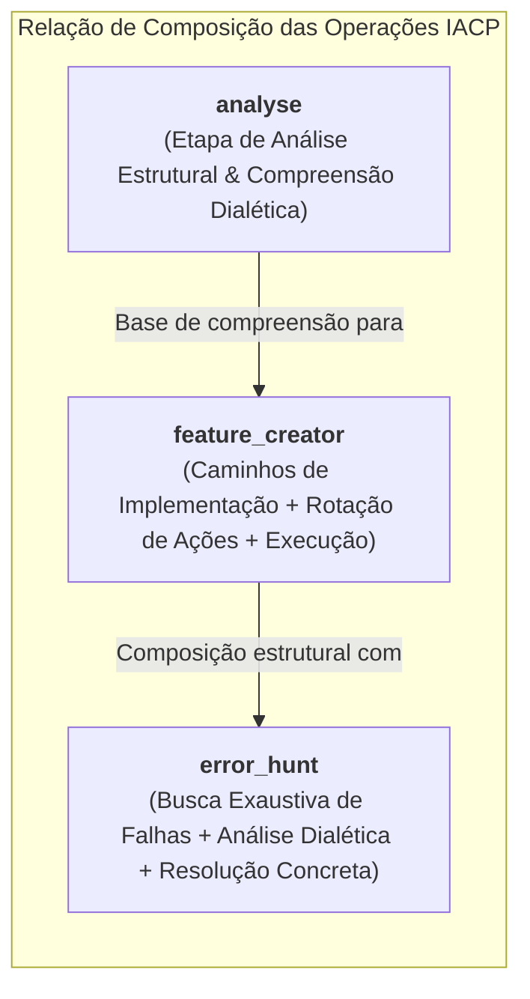
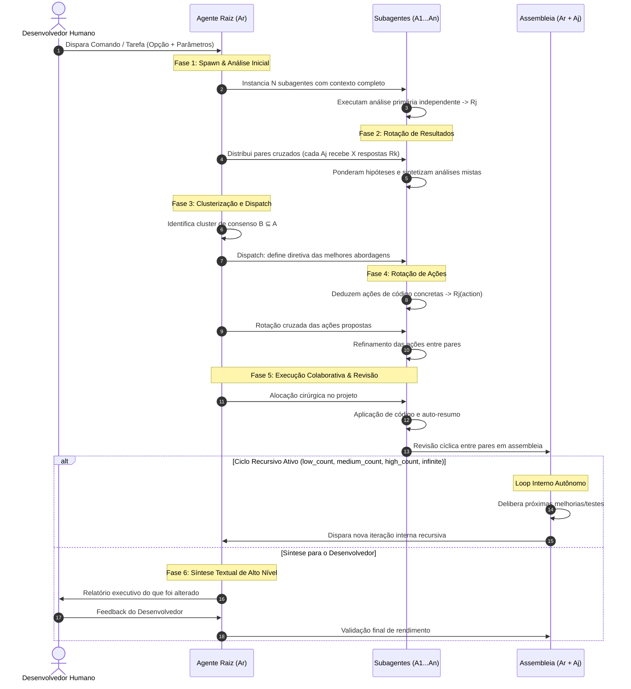
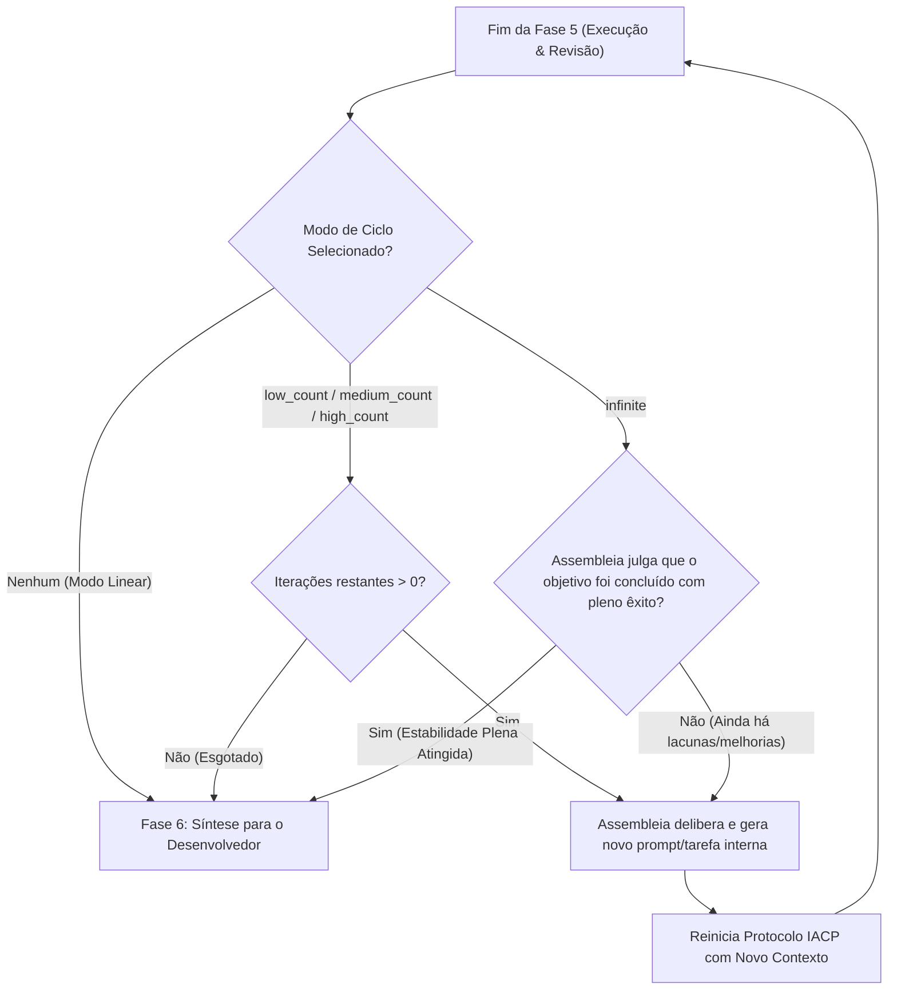

# IACP: Internal Agent Communication Protocol
*(Protocolo de Comunicação Interna entre Agentes)*

> **Versão:** 1.0.0  
> **Status:** Ativo / Especificação Arquitetural  
> **Classificação:** Multi-Agent Consensus, Task Distribution & Recursive Code Refactoring Architecture  

---

## 1. Visão Geral e Fundamentos

O **IACP (Internal Agent Communication Protocol)** é uma arquitetura distribuída de comunicação, colaboração e consenso entre agentes autônomos de Inteligência Artificial. Projetada especificamente para o ciclo de vida de desenvolvimento de software (SDLC), auditoria de segurança, depuração e engenharia de software em larga escala, o IACP substitui a execução linear simples por um modelo de **consenso dialético com rotação cruzada de análises e ações**.

Ao submeter o código a múltiplos agentes operando sob variações estocásticas (diferentes sementes, temperaturas e trajetórias contextuais), o protocolo elimina pontos cegos cognitivos (*blind spots*) e reduz drasticamente alucinações antes de qualquer mutação física no projeto.

---

## 2. Atores e Notação Matemática

A arquitetura modela a rede de agentes através das seguintes definições formais:

| Símbolo | Definição | Atribuição |
| :--- | :--- | :--- |
| **$A_r$** | **Agente Raiz** *(Root Agent)* | Orquestrador principal. Não executa mutações de código no início; instancia os subagentes, gerencia o fluxo de contexto, computa a similaridade dos resultados, orquestra rotações e sintetiza os relatórios para a assembleia e o desenvolvedor. |
| **$A_j$** | **Subagente $j$** | Agente especialista $j \in \{1, 2, \dots, N\}$ instanciado por $A_r$, dotado do contexto completo do projeto e da diretiva operacional em vigor. |
| **$A$** | **Conjunto Total de Subagentes** | $A = \{A_1, A_2, \dots, A_N\}$, com cardinalidade $\|A\| = N$. |
| **$R_j$** | **Resultado do Agente $j$** | Parecer, diagnóstico ou plano de ação produzido pelo agente $A_j$ no estágio corrente da tarefa. |
| **$X$** | **Quórum de Rotação Cruzada** | Quantidade mínima de pareceres alheios ($R_k$, onde $k \neq j$) que cada subagente $A_j$ deve obrigatoriamente inspecionar e ponderar. Por padrão, $X = N - 1$ (avaliação exaustiva de todos os pares). |
| **$B$** | **Cluster de Similaridade / Consenso** | Subconjunto de agentes $B \subseteq A$ cujas conclusões convergiram acima do limiar semântico estipulado por $A_r$. |
| **$\mathcal{A}_{\text{sembleia}}$** | **Assembleia Geral** | Corpo deliberativo colegiado formado pela união do Agente Raiz com todos os subagentes: $\mathcal{A}_{\text{sembleia}} = \{A_r\} \cup A$. |

---

## 3. Matriz de Operações

O protocolo IACP categoriza as tarefas em três operações fundamentais, estabelecendo uma relação de equivalência e herança funcional entre elas:



### 3.1. `error_hunt` (Caça e Resolução de Erros)
- **Objetivo:** Rastrear, auditar e eliminar bugs, vulnerabilidades, race conditions, vazamentos de memória e desvios de regras de negócio incansavelmente.
- **Relação Formal:** $\text{error\_hunt} \equiv \text{feature\_creator} + \text{etapa de análise exaustiva adversarial}$.
- **Comportamento:** Os agentes analisam o sistema de forma minuciosa, mapeiam pontos de falha com evidências, rotacionam diagnósticos e aplicam correções com blindagem de testes.

### 3.2. `feature_creator` (Engenharia e Implementação de Funcionalidades)
- **Objetivo:** Projetar e implementar novas funcionalidades e refatorações arquiteturais robustas.
- **Comportamento:** Os agentes projetam propostas de implementação independentes, ponderam prós e contras via rotação de resultados, unem o melhor de cada abordagem e coordenam a escrita de código de maneira cirúrgica e atômica.

### 3.3. `analyse` (Auditoria, Explicação e Engenharia Reversa)
- **Objetivo:** Fornecer ao desenvolvedor um entendimento profundo, documentado e rotacionado sobre a mecânica da aplicação, sem mutação de código.
- **Relação Formal:** $\text{analyse} \equiv \text{primeira etapa de } \text{error\_hunt}$.
- **Comportamento:** Os subagentes investigam a base de código e rotacionam explicações sob diferentes prismas (segurança, escalabilidade, acoplamento, performance), gerando um parecer consolidado e sintetizado pelo agente raiz $A_r$.

---

## 4. Fluxo Operacional: As 6 Fases do Protocolo



### Fase 1: Spawn e Análise Inicial
1. O Agente Raiz $A_r$ recebe a diretiva do usuário ou da iteração recursiva anterior.
2. $A_r$ instancia $N$ subagentes ($A_1, A_2, \dots, A_N$), fornecendo o contexto integral do repositório, diretrizes de governança e escopo da tarefa.
3. Cada subagente $A_j$ formula de forma isolada e sem interferência externa sua análise ou plano de implementação inicial, resultando no artefato $R_j$.

### Fase 2: Rotação de Resultados (*Result Rotation*)
1. $A_r$ orquestra uma matriz de permuta: cada subagente $A_n$ recebe os resultados $R_j$ gerados pelos outros subagentes ($j \neq n$).
2. Cada agente avalia no mínimo $X$ resultados de seus pares (por padrão, $X = N - 1$).
3. Cada $A_n$ pondera as forças e inconsistências das teses alheias em comparação com a sua própria, gerando uma **análise mista refinada**.

### Fase 3: Clusterização e Despacho (*Consensus & Dispatch*)
1. $A_r$ recolhe as análises mistas e mapeia os padrões de convergência.
2. É formado o cluster de similaridade $B \subseteq A$, isolando hipóteses inconsistentes e retendo os diagnósticos mais precisos.
3. **Regra de Ouro:** $A_r$ não implementa as mudanças diretamente neste momento. Em vez disso, formula o **Despacho de Ação**, estabelecendo os problemas e caminhos prioritários identificados pelo consenso.

### Fase 4: Rotação de Ações (*Action Rotation*)
1. Sob a nova diretriz de despacho, cada agente $A_j \in B$ mapeia o código-fonte e deduz o plano de ação físico exato ($R_j^{\text{action}}$): quais linhas, arquivos, contratos ou testes serão criados ou alterados.
2. Ocorre a **Rotação Cruzada de Ações**: cada $A_j$ inspeciona os planos de ação propostos por outros agentes.
3. A Assembleia refina e elimina potenciais conflitos de merge, redundâncias ou quebras de arquitetura.

### Fase 5: Execução Colaborativa e Revisão em Assembleia
1. $A_r$ atribui as tarefas aprovadas de maneira atômica e coordenada aos subagentes.
2. Os agentes executam as modificações físicas, criam/executam suítes de testes automatizados e geram seus resumos de intervenção.
3. **Revisão Paritária:** Cada agente revisa o impacto e as alterações realizadas pelos colegas.
4. A **Assembleia** ($\mathcal{A}_{\text{sembleia}} = \{A_r\} \cup A$) reúne-se para avaliar se as alterações cumpriram integralmente a especificação sem regressões.

### Fase 6: Síntese e Devolutiva ao Desenvolvedor
1. $A_r$ compila uma síntese executiva em linguagem natural, clara e objetiva.
2. **Diretriz de Comunicação:** Não despeja blocos extensos de código desnecessariamente; prioriza o impacto arquitetural, arquivos modificados, problemas solucionados e garantias de qualidade alcançadas.
3. O desenvolvedor valida o trabalho. O feedback do desenvolvedor é absorvido pela Assembleia para calibrar métricas de rendimento e aprendizado contínuo.

---

## 5. Arquitetura de Ciclos e Recursividade (*Cycles System*)

Um dos grandes diferenciais do IACP é a capacidade de operar em modo recursivo e em escala massiva através do mecanismo de **Ciclos de Assembleia**.

Em vez de devolver o controle ao desenvolvedor ao final de cada execução, a Assembleia pode realizar um **desvio de fluxo** (*feedback loop* autônomo):



### 5.1. Níveis de Ciclo

| Tipo de Ciclo | Faixa de Iterações | Aplicação Recomendada |
| :--- | :--- | :--- |
| **`low_count`** | 1 a 2 iterações recursivas | Ajustes pontuais, refatorações cirúrgicas de módulos isolados ou validação rápida de hipóteses. |
| **`medium_count`** | 3 a 5 iterações recursivas | Desenvolvimento completo de novas features moderadas, blindagem de segurança ou refatoração de camadas inteiras. |
| **`high_count`** | 6 a 10 iterações recursivas | Migrações arquiteturais complexas, cobertura de testes massiva e auditoria em larga escala. |
| **`infinite`** | Indeterminado com critério de parada autônomo | Operações autônomas em que a Assembleia itera continuamente até alcançar consenso unânime de que a meta foi atingida com estabilidade total. |

### 5.2. O Fator Estocástico e Segurança em Mudanças em Massa
Mesmo quando os subagentes utilizam a mesma versão do modelo de linguagem de fundação, o processo estocástico intrínseco (amostragem sob sementes aleatórias distintas, variações léxicas e formulações contextuais heterogêneas) faz com que cada agente atue sob uma **perspectiva cognitiva independente**.

Isso confere ao protocolo IACP:
1. **Redundância Crítica:** Erros ou alucinações de um agente individual são detectados e vetados na rotação por outros agentes.
2. **Refinamento Incremental:** Cada ciclo eleva o padrão do código através de críticas construtivas internas da Assembleia.
3. **Escalabilidade Segura:** Permite que centenas de arquivos sejam alterados de forma consistente, orientada a testes e imune a inconsistências conceituais.

---

## 6. Prompt Original Corrigido (Gramática e Semântica Refinadas)

Para fins de versionamento histórico e futuras iterações pelo desenvolvedor, segue a formulação formal e revisada da solicitação conceitual original:

```markdown
### Proposta Formal de Especificação do Protocolo IACP

Desejo definir formalmente uma arquitetura de operação de agentes inteligentes denominada **IACP (Internal Agent Communication Protocol)**. Trata-se de uma arquitetura de distribuição de tarefas multiagente altamente eficiente no gerenciamento, refatoração, caça a erros e evolução contínua de bases de código.

#### 1. Atores e Notação
* **$A_r$ (Agente Raiz / Root Agent):** Coordena e gera internamente uma quantidade predefinida $N$ de subagentes.
* **$A_j$ (Subagente $j$):** Subagentes $A_1, A_2, \dots, A_N$ responsáveis por analisar e executar tarefas sob o contexto integral do projeto.
* **$R_j$ (Resultado do Agente $j$):** Parecer, conclusão diagnóstica ou proposta de ação técnica formulada por $A_j$.
* **Assembleia:** Corpo deliberativo formado pela união de todos os agentes: $\mathcal{A}_{\text{sembleia}} = \{A_r\} \cup \{A_j \mid 1 \le j \le N\}$.

#### 2. Operações Fundamentais
* **`error_hunt`:** Varredura exaustiva de defeitos, inconsistências e vulnerabilidades no código, segundo o nível de profundidade configurado.
* **`feature_creator`:** Projeto e implementação de novas funcionalidades com base nas abordagens de engenharia mais eficientes.
* **`analyse`:** Análise estrutural e explicação aprofundada da mecânica do sistema (equivalente à primeira etapa do `error_hunt`, porém voltada para a elucidação técnica sem mutações de código).
* **Equivalência Estrutural:** Nota-se que $\text{error\_hunt} \equiv \text{feature\_creator} + \text{etapa de análise prévia}$, e $\text{analyse} \equiv \text{primeira etapa de } \text{error\_hunt}$.

#### 3. Ciclo de Execução e Rotação Dialética
1. **Análise Inicial:** Cada subagente $A_j$ recebe a tarefa e executa uma análise primária independente, gerando seu resultado $R_j$ (descrição dos problemas ou alternativas de implementação).
2. **Rotação de Resultados:** Cada agente $A_n$ recebe os resultados $R_j$ produzidos por outros agentes ($j \ne n$). Cada agente avalia um número $X$ de pareceres distintos (por padrão $X = N - 1$, ou seja, todos os demais), ponderando e combinando uma análise mista consensual.
3. **Convergência e Despacho (*Dispatch*):** O agente raiz $A_r$ processa as análises mistas e identifica o cluster de maior similaridade e consistência técnica ($B \subseteq A$). $A_r$ não implementa código diretamente; em vez disso, formula uma diretriz consensual de ação e despacha a próxima fase aos agentes.
4. **Rotação de Ações:** Os agentes mapeiam o código e definem as ações práticas necessárias ($R_j^{\text{action}}$). $A_r$ orquestra a rotação das propostas de ação, e os agentes avaliam criticamente os planos uns dos outros. A Assembleia consolida a estratégia de implementação ótima.
5. **Execução Paritária e Revisão em Assembleia:** Os agentes aplicam as alterações no código de forma atômica e sintetizam o que foi alterado. As mudanças passam por revisão cíclica entre pares e validação pela Assembleia.
6. **Síntese Executiva:** $A_r$ consolida um relatório textual de alto nível para o desenvolvedor, explicando de forma clara e objetiva o impacto e as soluções implementadas (sem despejo de código bruto desnecessário). O desenvolvedor fornece feedback, permitindo que a Assembleia mensure a precisão e o rendimento obtidos.

#### 4. Mecanismo de Ciclos Recursivos (*Cycles*)
O protocolo incorpora um mecanismo de autoiteração contínua: em vez de devolver imediatamente a execução ao desenvolvedor, a Assembleia pode avaliar o estado resultante do projeto, identificar novas oportunidades de melhoria ou cenários de teste adicionais, e disparar uma nova iteração integral do protocolo de forma recursiva e autônoma.

* **Modalidades:** `low_count`, `medium_count`, `high_count` e `infinite`.
* **Critério de Parada para `infinite`:** O ciclo encerra-se quando a Assembleia obtiver consenso unânime de que a meta foi atingida com pleno êxito e estabilidade comprovada.
* **Garantia de Variabilidade Estocástica:** Subagentes distintos (mesmo baseados no mesmo modelo de linguagem), atuando sob sementes e percursos estocásticos independentes, examinam a aplicação sob múltiplos prismas complementares, viabilizando alterações massivas em escala com alta segurança e resiliência.
```

---

## 7. Roteiro de Adoção e Próximos Passos (Backlog IACP)

- [ ] **Módulo de Métricas de Similaridade:** Implementar matriz de distância semântica (cosseno sobre embeddings dos diagnósticos $R_j$) para clustering automatizado do grupo $B$.
- [ ] **Arbitragem Anti-Impasse:** Definir heurísticas para desempate quando o cluster $B$ apresentar divergências polarizadas (50% vs 50%).
- [ ] **Integração com Ferramentas do Workspace:** Mapear o disparo de subagentes via MCP / CLI do ecossistema e persistência de histórico de rotações.
