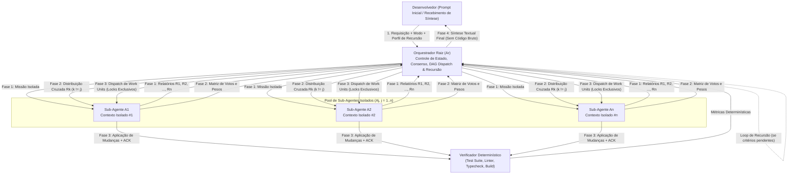
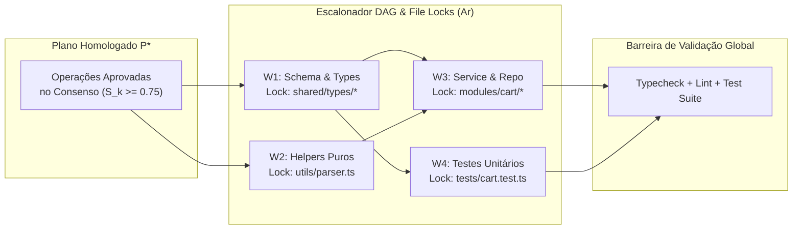
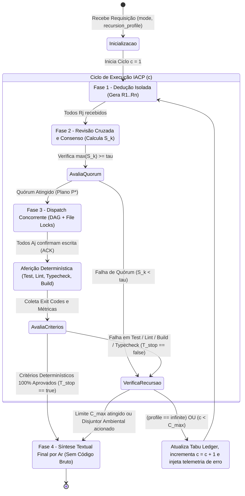

# Especificação Técnica: Internal Agent Communication Protocol (IACP)

| Metadado                       | Valor                                                                                     |
| :----------------------------- | :---------------------------------------------------------------------------------------- |
| **Identificador do Protocolo** | `IACP-v1.0`                                                                               |
| **Status**                     | Homologado / Especificação Formal                                                         |
| **Escopo**                     | Orquestração Multi-Agente, Consenso Estatístico, Execução Concorrente e Recursão Autônoma |
| **Localização**                | `docs/IACP_SPEC.md`                                                                       |

---

## 1. Visão Geral e Objetivos Arquiteturais

O **Internal Agent Communication Protocol (IACP)** define a arquitetura formal de comunicação, sincronização de estado, deliberação estatística e despacho de trabalho entre um agente orquestrador central ($A_r$) e um conjunto dinâmico de $n$ sub-agentes especialistas ($A_j$, onde $j \in \{1, 2, \dots, n\}$).

O protocolo foi projetado para eliminar três falhas clássicas de sistemas multi-agentes baseados em LLMs:

1. **Viés de Ancoragem e Groupthink:** Sub-agentes que compartilham o mesmo contexto inicial tendem a convergir prematuramente para a primeira hipótese gerada. O IACP impõe isolamento estrito na Fase 1.
2. **Colisão de Escrita em Concorrência:** Execuções paralelas sem controle de região crítica corrompem a árvore de arquivos. O IACP utiliza particionamento em Grafo Acíclico Dirigido (DAG) com _file-level locking_ na Fase 3.
3. **Poluição Cognitiva na Interface Humana:** Despejar blocos extensos de código bruto ao final de uma operação multi-agente reduz a legibilidade executiva. O IACP determina que a saída final de $A_r$ para o desenvolvedor seja uma síntese textual pura, estruturada e livre de trechos brutos de código.

---

## 2. Topologia do Sistema e Modos Operacionais

### 2.1. Entidades da Topologia

- **Orquestrador Raiz ($A_r$ — _Root Orchestrator_):** Nó coordenador central responsável pelo gerenciamento do ciclo de vida da sessão, particionamento de contexto, agregação matemática na revisão cruzada, escalonamento de locks de escrita, aferição de critérios determinísticos de parada e síntese textual final para o desenvolvedor. $A_r$ não executa mutações diretas de código durante as fases de exploração.
- **Sub-Agentes Operacionais ($A_j$ — _Worker/Specialist Sub-Agents_, $j \in \{1 \dots n\}$):** Instâncias autônomas de execução com contexto isolado. Cada $A_j$ opera sob um conjunto restrito de ferramentas conforme a fase ativa do pipeline (somente leitura nas Fases 1 e 2; leitura, escrita restrita ao escopo alocado e execução de verificadores na Fase 3).



### 2.2. Modos Operacionais (`operational_mode`)

O comportamento inferencial de $A_r$ e dos sub-agentes $A_j$, bem como os pesos da função de consenso, adaptam-se dinamicamente ao modo operacional declarado na inicialização da sessão:

| Modo Operacional              | Identificador     | Objetivo Primário                                                                                                                                                                      | Escopo de Mutação na Fase 3                                                                                                                | Pesos Prioritários no Consenso (Fase 2)                                                                         |
| :---------------------------- | :---------------- | :------------------------------------------------------------------------------------------------------------------------------------------------------------------------------------- | :----------------------------------------------------------------------------------------------------------------------------------------- | :-------------------------------------------------------------------------------------------------------------- |
| **Caça a Erros**              | `error_hunt`      | Identificação determinística e probabilística de bugs, condições de corrida, vazamentos de memória, falhas de tipagem, regressões e vulnerabilidades de segurança.                     | Correções cirúrgicas em arquivos de implementação e adição obrigatória de testes de regressão.                                             | Reprodutibilidade da causa raiz ($0.40$), Ausência de efeitos colaterais ($0.35$), Cobertura de borda ($0.25$). |
| **Criação de Funcionalidade** | `feature_creator` | Desenho arquitetural, decomposição em camadas (ex: Routes $\rightarrow$ Controller $\rightarrow$ Service $\rightarrow$ Repository / UI) e implementação concorrente de novas features. | Criação de novos módulos, evolução de schemas, serviços, interfaces e suítes de testes.                                                    | Aderência arquitetural ($0.35$), Modularidade/Coesão ($0.35$), Escalabilidade e Tipagem ($0.30$).               |
| **Análise Técnica**           | `analyse`         | Auditoria profunda de arquitetura, mapeamento de _blast radius_, avaliação de débito técnico, complexidade ciclomática e modelagem de performance.                                     | Somente leitura sobre o código-fonte de produção (`read_only: true`); escrita restrita a relatórios e artefatos documentais se solicitado. | Profundidade analítica ($0.45$), Precisão de evidências empíricas ($0.35$), Clareza de recomendações ($0.20$).  |

---

## 3. Pipeline de Execução em Quatro Fases

Toda iteração (ciclo $c$) do protocolo IACP percorre sequencialmente quatro fases estritas. Nenhuma fase pode ser iniciada antes da conclusão formal ou _timeout_ controlado da fase imediatamente anterior.

```mermaid
sequenceDiagram
    autonumber
    actor Dev as Desenvolvedor
    participant Ar as Orquestrador (Ar)
    participant A1 as Sub-Agente (A1)
    participant A2 as Sub-Agente (A2)
    participant An as Sub-Agente (An)
    participant CI as Motor de Validação (Test/Lint/Build)

    Dev->>Ar: Inicia Sessão (mode, recursion_profile, target_scope)

    rect rgb(30, 45, 65)
        Note over Ar,An: FASE 1: Dedução Isolada (Geração de Relatórios Rj)
        par Execução em Sandboxes Independentes
            Ar->>A1: DISPATCH_DEDUCTION (Contexto Isolado, Seed #1)
            Ar->>A2: DISPATCH_DEDUCTION (Contexto Isolado, Seed #2)
            Ar->>An: DISPATCH_DEDUCTION (Contexto Isolado, Seed #n)
        and Coleta de Relatórios
            A1-->>Ar: REPORT_SUBMISSION (Relatório R1)
            A2-->>Ar: REPORT_SUBMISSION (Relatório R2)
            An-->>Ar: REPORT_SUBMISSION (Relatório Rn)
        end
    end

    rect rgb(45, 35, 65)
        Note over Ar,An: FASE 2: Revisão Cruzada e Consenso Estatístico
        Ar->>Ar: Anonimiza R1..Rn e monta matriz de distribuição (k != j)
        par Peer Review Adversarial
            Ar->>A1: CROSS_REVIEW_REQUEST (Avaliar {R2, ..., Rn})
            Ar->>A2: CROSS_REVIEW_REQUEST (Avaliar {R1, ..., Rn})
            Ar->>An: CROSS_REVIEW_REQUEST (Avaliar {R1, R2, ...})
        and Submissão de Pareceres
            A1-->>Ar: CROSS_REVIEW_EVALUATION (Scores, Vetos, Pesos)
            A2-->>Ar: CROSS_REVIEW_EVALUATION (Scores, Vetos, Pesos)
            An-->>Ar: CROSS_REVIEW_EVALUATION (Scores, Vetos, Pesos)
        end
        Ar->>Ar: Calcula Consenso Estatístico (S_k) e seleciona Plano Homologado P*
    end

    rect rgb(25, 55, 45)
        Note over Ar,CI: FASE 3: Etapa de Dispatch e Implementação Concorrente
        Ar->>Ar: Decompõe P* em DAG de Work Units (W1..Wm) com File Locks disjuntos
        par Implementação Concorrente
            Ar->>A1: CODE_DISPATCH_ASSIGNMENT (Work Unit W1 + Lock L1)
            Ar->>A2: CODE_DISPATCH_ASSIGNMENT (Work Unit W2 + Lock L2)
            Ar->>An: CODE_DISPATCH_ASSIGNMENT (Work Unit Wn + Lock Ln)
        and Confirmação de Escrita
            A1-->>Ar: IMPLEMENTATION_ACK (Status, Arquivos Modificados)
            A2-->>Ar: IMPLEMENTATION_ACK (Status, Arquivos Modificados)
            An-->>Ar: IMPLEMENTATION_ACK (Status, Arquivos Modificados)
        end
        Ar->>CI: Executa Verificação Determinística Global (Test, Lint, Typecheck, Build)
        CI-->>Ar: Telemetria de Validação (Exit Codes, Métricas)
    end

    rect rgb(60, 45, 30)
        Note over Ar,Dev: FASE 4: Síntese Textual Final (Omissão Estrita de Código Bruto)
        Ar->>Ar: Filtra diffs/snippets brutos e consolida narrativa técnica executiva
        Ar->>Dev: SYNTHESIS_OUTPUT (Resumo Executivo, Causas, Arquivos, Validação)
    end
```



---

### 3.1. Fase 1: Dedução Isolada e Geração de Relatórios ($R_j$)

Na Fase 1, o objetivo é maximizar a diversidade epistêmica e impedir que um sub-agente influencie prematuramente a cadeia de raciocínio dos demais.

1. **Isolamento de Contexto (_Zero Cross-Talk_):**
   - O canal de mensagens horizontais ($A_j \leftrightarrow A_k$) permanece fisicamente bloqueado.
   - Cada sub-agente $A_j$ recebe o problema a partir de $A_r$, podendo receber heurísticas de exploração distintas (ex: $A_1$ focado em análise de fluxo de dados, $A_2$ em condições de contorno e concorrência, $A_3$ em contratos de tipagem e invariantes de banco de dados).
2. **Permissões de Ferramentas:**
   - Estritamente `READ_ONLY` sobre o repositório (leitura de AST, busca textual, inspeção de dependências e logs). Nenhuma mutação de arquivo é permitida na Fase 1.
3. **Estrutura Formal do Relatório ($R_j$):**
   Cada sub-agente $A_j$ deve produzir e enviar a $A_r$ um artefato estruturado $R_j$ contendo:
   - `report_id`: Identificador único do relatório no ciclo atual (`R_1`, `R_2`, ..., `R_n`).
   - `findings`: Lista formal de descobertas, anomalias ou requisitos arquiteturais mapeados.
   - `proposed_operations`: Conjunto de operações abstratas propostas por arquivo (`CREATE`, `MODIFY`, `DELETE`), descrevendo a semântica da alteração, assinaturas afetadas e invariantes preservadas.
   - `risk_assessment`: Avaliação de impacto colateral (_blast radius_) e risco de regressão ($[0.0, 1.0]$).
   - `self_confidence`: Grau de confiança interna do agente na completude de sua proposta ($[0.0, 1.0]$).

---

### 3.2. Fase 2: Revisão Cruzada e Consenso Estatístico

Recebidos todos os relatórios $\mathcal{R} = \{R_1, R_2, \dots, R_n\}$, o orquestrador $A_r$ inicia a rodada de avaliação adversarial por pares.

1. **Anonimização e Distribuição Cruzada:**
   - $A_r$ remove metadados de autoria de cada $R_k$ (prevenindo viés de auto-preferência ou hierarquia) e distribui para cada agente $A_j$ o conjunto concorrente $\mathcal{R}_{-j} = \mathcal{R} \setminus \{R_j\}$.
   - Em topologias de grande escala ($n > 7$), $A_r$ pode aplicar um grafo regular $d$-conectado onde cada $A_j$ avalia exatamente $d$ relatórios sorteados deterministicamente ($3 \le d < n$).
2. **Votação Multidimensional e Veto Técnico:**
   Cada agente revisor $A_j$ avalia cada relatório concorrente $R_k \in \mathcal{R}_{-j}$ segundo quatro dimensões normalizadas no intervalo $[0.0, 1.0]$:
   - $ M\_{j,k}^{(1)} $ — **Corretude Técnica (`correctness`):** Validade lógica e ausência de bugs na proposta.
   - $ M\_{j,k}^{(2)} $ — **Aderência Arquitetural (`architecture_fit`):** Respeito ao encapsulamento de camadas e convenções do projeto.
   - $ M\_{j,k}^{(3)} $ — **Minimalismo e Segurança (`safety_minimalism`):** Menor superfície de mudança necessária e ausência de vulnerabilidades.
   - $ M\_{j,k}^{(4)} $ — **Verificabilidade (`testability`):** Facilidade de comprovação determinística via testes automatizados.
   - **Flag de Veto Crítico ($V_{j,k} \in \{0, 1\}$):** Acionada apenas se $A_j$ comprovar uma falha bloqueante determinística em $R_k$ (ex: quebra de compatibilidade de schema, condição de corrida provada, violação de segurança). Todo veto exige justificativa técnica verificável (`veto_evidence`).
3. **Formulação Matemática do Consenso Estatístico:**
   O escore composto atribuído pelo avaliador $A_j$ ao relatório $R_k$ é dado por:
   $$s_{j,k} = \sum_{m=1}^{4} w_m \cdot M_{j,k}^{(m)}$$
   onde $\sum_{m=1}^{4} w_m = 1$ reflete os pesos do `operational_mode` ativo.

   Para mitigar _outliers_ (avaliações excessivamente lenientes ou punitivas), $A_r$ calcula o **Escore de Consenso Ponderado e Aparado ($S_k$)** utilizando a média aparada (_trimmed mean_ $\mu_{\text{trim}}$) combinada com o desvio absoluto mediano ($\text{MAD}$) e penalidade de veto validado:
   $$S_k = \left( \frac{\sum_{j \neq k} \alpha_j \cdot s_{j,k}}{\sum_{j \neq k} \alpha_j} - \lambda \cdot \text{MAD}(\{s_{j,k}\}_{j \neq k}) \right) \cdot \prod_{j \neq k} (1 - \gamma \cdot V_{j,k}^{\text{valid}})$$

   | Símbolo                  | Definição                                                             | Valor Padrão |
   | :----------------------- | :-------------------------------------------------------------------- | :----------- |
   | $\alpha_j$               | Peso de confiabilidade histórica do agente avaliador $A_j$            | $1.0$        |
   | $\lambda$                | Fator de penalização por divergência/alta variância entre revisores   | $0.25$       |
   | $V_{j,k}^{\text{valid}}$ | Veto técnico validado sintática/semanticamente por $A_r$ ($0$ ou $1$) | $\{0, 1\}$   |
   | $\gamma$                 | Coeficiente de atenuação por veto crítico confirmado                  | $0.80$       |
   | $\tau$                   | Limiar mínimo de consenso (_Consensus Threshold_) para homologação    | $0.75$       |

4. **Seleção ou Fusão de Propostas:**
   - **Proposta Dominante:** Se $\max_k(S_k) \ge \tau$, o relatório $R^* = \arg\max_k(S_k)$ é eleito como base do Plano de Execução $P^*$.
   - **Fusão Ortogonal (_Hybrid Merge_):** Se dois ou mais relatórios $R_a, R_b$ possuem $S \ge \tau$ e abordam partições disjuntas do problema (ex: $R_a$ corrige a camada de serviço e $R_b$ adiciona cobertura de testes de fronteira), $A_r$ realiza a união dos grafos de operação em $P^* = R_a \cup R_b$.
   - **Falha de Quórum:** Se $\max_k(S_k) < \tau$, $A_r$ rejeita a rodada atual, agrega as críticas da Fase 2 como restrições negativas e aciona o **Módulo de Recursão Autônoma** (Seção 4) retornando à Fase 1.

---

### 3.3. Fase 3: Etapa de Dispatch e Implementação Concorrente

Uma vez consolidado o Plano Homologado $P^*$ (exceto quando `operational_mode == "analyse"` sem geração de artefatos), o orquestrador $A_r$ traduz as decisões aprovadas em unidades atômicas de trabalho (_Work Units_ $W_1, W_2, \dots, W_m$).

1. **Construção do DAG de Dependências e Alocação de Locks:**
   - $A_r$ analisa a árvore de importações dos arquivos listados em $P^*$.
   - Dois sub-agentes **nunca** podem receber permissão de escrita simultânea sobre o mesmo arquivo:
     $$\forall a \neq b, \quad \text{WriteScope}(W_a) \cap \text{WriteScope}(W_b) = \emptyset$$
   - Caso $W_b$ dependa de tipos ou interfaces exportados por $W_a$, $A_r$ posiciona $W_a$ no Nível 0 do DAG e $W_b$ no Nível 1, despachando $W_b$ somente após o `IMPLEMENTATION_ACK` de $W_a$.
2. **Execução Concorrente pelos Sub-Agentes $A_j$:**
   - Cada sub-agente $A_j$ designado aplica as transformações de código estritamente dentro de seu `WriteScope(W_j)`.
   - Tentativas de escrita fora de `WriteScope(W_j)` resultam em erro imediato de protocolo (`SCOPE_LOCK_VIOLATION`) e rollback atômico da unidade $W_j$.
3. **Barreira de Sincronização e Verificação Global:**
   - Após receber `IMPLEMENTATION_ACK` de todas as unidades $W_1 \dots W_m$, $A_r$ fecha a barreira de escrita e invoca a bateria de validação determinística global (compilador/typechecker, linter e executor de testes).



---

### 3.4. Fase 4: Síntese Textual Final (Restrição de Omissão de Código Bruto)

Concluída a Fase 3 (e satisfeitas as condições de parada do módulo de recursão), o orquestrador $A_r$ compila a resposta final destinada ao desenvolvedor humano.

> [!IMPORTANT]
> **Regra Invariante da Fase 4 (`NO_RAW_CODE_IN_SYNTHESIS`):** A síntese textual gerada por $A_r$ para o desenvolvedor **DEVE OMITIR ESTRITAMENTE trechos brutos de código-fonte, blocos de implementação multi-linha ou diffs literais**. As modificações reais já residem persistidas no sistema de arquivos (working tree) e foram verificadas na Fase 3.

#### Estrutura Obrigatória da Síntese Textual de $A_r$:

1. **Resumo Executivo da Operação:** Síntese em alto nível do que foi diagnosticado, decidido pelo consenso e implementado.
2. **Decisões de Consenso e Descarte:** Explicação concisa de por que a abordagem vencedora superou as hipóteses alternativas durante a Fase 2 (incluindo eventuais vetos aplicados).
3. **Inventário de Arquivos Modificados e Responsabilidades:** Lista ou tabela referenciando os caminhos dos arquivos alterados e o papel semântico de cada mudança (mencionando apenas identificadores simbólicos inline, como nomes de funções, classes ou constantes, sem blocos de código).
4. **Telemetria de Validação e Convergência:** Relatório quantitativo de ciclos executados, escore de consenso atingido e status final de testes, linter e build.

---

## 4. Módulo de Recursão Autônoma (`Autonomous Recursion Module`)

O Módulo de Recursão Autônoma governa a repetição cíclica do pipeline (Fases $1 \rightarrow 2 \rightarrow 3$) quando o estado do sistema ainda não atingiu a convergência esperada ou quando novas falhas emergem após uma rodada de implementação.

### 4.1. Perfis de Ciclo de Recursão (`recursion_profile`)

| Perfil de Recursão | Limite de Ciclos ($C_{\max}$)        | Timeout Global Sugerido               | Estratégia de Decaimento / Refinamento                                                                                                    | Caso de Uso Recomendado                                                                                                                                   |
| :----------------- | :----------------------------------- | :------------------------------------ | :---------------------------------------------------------------------------------------------------------------------------------------- | :-------------------------------------------------------------------------------------------------------------------------------------------------------- |
| `low_count`        | $1 \text{ a } 2$ ciclos              | $180\text{ s}$                        | Execução direta; se o Ciclo 1 falhar na validação, executa 1 ciclo corretivo focado nos erros reportados.                                 | Correções pontuais de bugs simples, ajustes de configuração ou análises rápidas.                                                                          |
| `medium_count`     | $3 \text{ a } 5$ ciclos              | $600\text{ s}$                        | Refinamento progressivo de escopo: reduz a temperatura de amostragem dos agentes $A_j$ a cada ciclo e injeta logs de falha anteriores.    | Implementação de features modulares, refatorações multi-arquivo e caça a bugs de média complexidade.                                                      |
| `high_count`       | $6 \text{ a } 12$ ciclos             | $1800\text{ s}$                       | Exploração em profundidade com poda de hipóteses invalidadas (_Negative Constraint Accumulation_) e re-balanceamento de pesos $\alpha_j$. | Auditorias completas de segurança/performance, refatorações estruturais de banco/API e resolução de condições de corrida complexas.                       |
| `infinite`         | $\infty$ (Sem limite fixo de ciclos) | Governado por _Watchdog_ de Progresso | Execução autônoma contínua até que **100% dos critérios determinísticos mensuráveis sejam satisfeitos simultaneamente**.                  | Missões críticas de estabilização (_Zero-Defect Convergence_), blindagem completa de suítes de teste e erradicação exaustiva de erros de compilação/lint. |

### 4.2. Semântica Estrita do Modo `infinite` e Critérios Determinísticos de Parada

No modo `infinite`, é **expressamente proibido** interromper a execução com base em estimativas subjetivas dos agentes (como _"parece estar funcionando"_ ou _"a maioria dos problemas foi resolvida"_). O orquestrador $A_r$ mantém o loop Fases $1 \rightarrow 2 \rightarrow 3$ ativo enquanto o predicado booleano global $\mathcal{T}_{\text{stop}}$ avaliar como `false`.

A interrupção bem-sucedida da recursão no modo `infinite` exige que a conjunção lógica de todos os **Critérios Determinísticos Mensuráveis** abaixo seja verdadeira ($\mathcal{T}_{\text{stop}} == \text{true}$):

$$\mathcal{T}_{\text{stop}} \iff (E_{\text{test}} = 0) \land (E_{\text{lint}} = 0) \land (E_{\text{build}} = 0) \land (E_{\text{type}} = 0) \land (S_{k^*} \ge \tau) \land (B_{\text{crit}} = 0)$$

| Métrica Determinística             | Variável           | Condição de Parada Obrigatória                                      | Fonte de Aferição (Verdade de Campo)                                         |
| :--------------------------------- | :----------------- | :------------------------------------------------------------------ | :--------------------------------------------------------------------------- |
| **Suíte de Testes Automatizados**  | $E_{\text{test}}$  | `exit_code == 0` **e** `failed_tests == 0` **e** `passed_tests > 0` | Executor de testes do projeto (ex: `npm test`, `vitest`, `jest`, `maestro`). |
| **Análise Estática e Linter**      | $E_{\text{lint}}$  | `exit_code == 0` **e** `error_count == 0`                           | Motor de linting configurado (ex: `eslint`, `biome`, `ruff`).                |
| **Compilação / Empacotamento**     | $E_{\text{build}}$ | `exit_code == 0` sem artefatos corrompidos                          | Pipeline de build do projeto (ex: `npm run build`, `tsc`, `gradle`).         |
| **Verificação Estrita de Tipos**   | $E_{\text{type}}$  | `exit_code == 0` **e** `diagnostic_errors == 0`                     | Compilador estático de tipos (ex: `tsc --noEmit`).                           |
| **Limiar de Consenso Estatístico** | $S_{k^*}$          | $S_{k^*} \ge \tau$ (padrão $\tau = 0.75$)                           | Matriz de avaliação cruzada calculada por $A_r$ na Fase 2.                   |
| **Pendências Críticas Abertas**    | $B_{\text{crit}}$  | `open_critical_blockers == 0`                                       | Contador de vetos não resolvidos ou requisitos obrigatórios pendentes.       |

#### Salvaguardas de Estabilidade no Modo `infinite` (_Anti-Oscillation & Deadlock Breakers_):

Embora o modo `infinite` não possua teto de ciclos pré-fixado para tarefas em progresso convergente, $A_r$ monitora a entropia do sistema a cada ciclo $c$ para impedir loops estéreis:

1. **Memória de Restrições Negativas (_Tabu Search Ledger_):** Toda alteração que causou falha na Fase 3 do ciclo $c$ tem sua assinatura registrada em um ledger imutável da sessão. Na Fase 1 do ciclo $c+1$, os sub-agentes $A_j$ são proibidos de propor novamente uma solução com a mesma assinatura de falha.
2. **Detector de Oscilação de Estado (_Cycle Hash Detection_):** Ao final de cada Fase 3, $A_r$ computa o hash criptográfico `SHA-256` da árvore de arquivos modificados ($H_c$). Se $H_c == H_{c-k}$ (para algum $k \ge 1$) com os mesmos erros determinísticos, $A_r$ detecta um ciclo de oscilação, força a mutação dos prompts de exploração dos sub-agentes $A_j$ e exige uma abordagem estruturalmente distinta.
3. **Disjuntor de Estagnação Estrita (`max_stagnant_cycles`):** Caso o vetor de distância para a meta $\Delta_c = (E_{\text{test}} + E_{\text{lint}} + E_{\text{build}} + E_{\text{type}})$ não apresente redução nem mudança de assinatura de erro por $K_{\text{stag}}$ ciclos consecutivos (padrão $K_{\text{stag}} = 10$), $A_r$ realiza rollback para o estado de menor erro $\min(\Delta)$ registrado na sessão e emite um alerta de bloqueio ambiental externo (ex: banco de dados offline, credencial ausente ou dependência externa indisponível) na Fase 4.



---

## 5. Tabelas de Parâmetros de Configuração do Protocolo

### 5.1. Parâmetros Globais do Orquestrador ($A_r$)

| Parâmetro                      | Tipo              | Valores Permitidos / Faixa                            | Padrão           | Descrição Técnica                                                                                        |
| :----------------------------- | :---------------- | :---------------------------------------------------- | :--------------- | :------------------------------------------------------------------------------------------------------- |
| `session_id`                   | `string (UUIDv4)` | Formato RFC 4122                                      | Gerado por $A_r$ | Identificador único global da sessão de orquestração IACP.                                               |
| `operational_mode`             | `enum`            | `error_hunt`, `feature_creator`, `analyse`            | Obrigatório      | Define o objetivo operacional, permissões de escrita e pesos da função de consenso.                      |
| `agent_pool_size` ($n$)        | `integer`         | $2 \le n \le 16$                                      | $3$              | Quantidade de sub-agentes $A_j$ instanciados em paralelo nas Fases 1 a 3.                                |
| `recursion_profile`            | `enum`            | `low_count`, `medium_count`, `high_count`, `infinite` | `medium_count`   | Define a política de repetição cíclica e o regime de parada da sessão.                                   |
| `consensus_threshold` ($\tau$) | `float`           | $[0.50, 0.95]$                                        | $0.75$           | Escore estatístico mínimo na Fase 2 para homologação de um plano $P^*$.                                  |
| `variance_penalty` ($\lambda$) | `float`           | $[0.00, 0.50]$                                        | $0.25$           | Fator de penalização sobre o Desvio Absoluto Mediano ($\text{MAD}$) das notas de revisão.                |
| `veto_attenuation` ($\gamma$)  | `float`           | $[0.50, 1.00]$                                        | $0.80$           | Redução proporcional aplicada ao escore de um relatório que recebeu veto técnico validado.               |
| `phase_timeout_ms`             | `integer`         | $10000 \le t \le 600000$                              | $120000$         | Tempo máximo de espera por fase antes de $A_r$ prosseguir com o quórum disponível.                       |
| `min_quorum_ratio`             | `float`           | $[0.51, 1.00]$                                        | $0.67$           | Proporção mínima de sub-agentes $A_j$ respondentes para validar as Fases 1 e 2.                          |
| `enforce_no_raw_code`          | `boolean`         | `true` (imutável na Fase 4)                           | `true`           | Filtra e bloqueia a emissão de blocos de código ou diffs literais na síntese final para o desenvolvedor. |

### 5.2. Códigos de Erro Internos do Protocolo IACP

| Código IACP                        | Severidade     | Fase Associada     | Descrição e Ação de Recuperação                                                                                                    |
| :--------------------------------- | :------------- | :----------------- | :--------------------------------------------------------------------------------------------------------------------------------- |
| `IACP_ERR_QUORUM_TIMEOUT`          | `WARN / RETRY` | Fases 1 e 2        | Número de sub-agentes respondentes abaixo de `min_quorum_ratio`. $A_r$ reinicia os agentes lentos ou reexecuta a fase.             |
| `IACP_ERR_CONSENSUS_REJECTED`      | `NON_FATAL`    | Fase 2             | Nenhuma proposta atingiu $\max_k(S_k) \ge \tau$. Aciona novo ciclo de recursão com restrições negativas.                           |
| `IACP_ERR_SCOPE_LOCK_VIOLATION`    | `CRITICAL`     | Fase 3             | Um sub-agente $A_j$ tentou modificar arquivo fora de seu `WriteScope(W_j)`. Mudança revertida e unidade realocada.                 |
| `IACP_ERR_DAG_CYCLE_DETECTED`      | `CRITICAL`     | Fase 3             | Dependência circular detectada entre unidades de trabalho. $A_r$ funde as unidades conflitantes em um único lock sequencial.       |
| `IACP_ERR_DETERMINISTIC_GATE_FAIL` | `NON_FATAL`    | Fase 3 (Validação) | Falha em `test`, `lint`, `typecheck` ou `build`. Mantém o loop ativo se o perfil de recursão permitir (obrigatório em `infinite`). |
| `IACP_ERR_RAW_CODE_LEAK_BLOCKED`   | `SANITIZED`    | Fase 4             | Detectado bloco de código bruto no rascunho de síntese. O higienizador de $A_r$ converte o trecho em descrição textual simbólica.  |

---

## 6. Especificação de Envelope e Exemplos de Payload

Todas as mensagens trocadas entre $A_r$ e $A_j$ utilizam objetos JSON UTF-8 serializados sob um **Envelope Canônico IACP**, garantindo rastreabilidade por ciclo, fase e correlação.

### 6.1. Exemplo 1: Despacho de Dedução Isolada ($A_r \rightarrow A_j$ | Fase 1)

Mensagem enviada por $A_r$ para o sub-agente $A_2$ iniciando uma investigação em modo `error_hunt` sob perfil de recursão `infinite`.

```json
{
  "iacp_version": "1.0",
  "message_id": "msg-f1-0092a1c4",
  "session_id": "sess-8841-4b9c-9d12-77e1029abc01",
  "cycle_index": 1,
  "phase": "PHASE_1_ISOLATED_DEDUCTION",
  "timestamp": "2026-10-21T17:30:00.112Z",
  "sender": "Ar",
  "recipient": "A2",
  "config": {
    "operational_mode": "error_hunt",
    "recursion_profile": "infinite",
    "isolation_policy": "STRICT_SANDBOX_READ_ONLY",
    "exploration_heuristic": "CONCURRENCY_AND_BOUNDARY_CONDITIONS"
  },
  "payload": {
    "problem_statement": "Condição de corrida intermitente na atualização de votos de ocorrências de preço sob alta concorrência, ocasionando divergência no saldo de XP do autor.",
    "target_scope": [
      "src/backend/src/modules/ocurrency/ocurrency.service.ts",
      "src/backend/src/shared/database/repositories/ocurrency.repository.ts"
    ],
    "negative_constraints_ledger": [],
    "deterministic_targets": {
      "require_tests_pass": true,
      "require_zero_lint_errors": true,
      "require_zero_type_errors": true,
      "require_build_success": true
    }
  }
}
```

### 6.2. Exemplo 2: Submissão de Relatório $R_j$ ($A_j \rightarrow A_r$ | Fase 1)

Resposta do sub-agente $A_2$ entregando seu relatório isolado $R_2$ ao orquestrador $A_r$.

```json
{
  "iacp_version": "1.0",
  "message_id": "msg-f1-7731b8e9",
  "correlation_id": "msg-f1-0092a1c4",
  "session_id": "sess-8841-4b9c-9d12-77e1029abc01",
  "cycle_index": 1,
  "phase": "PHASE_1_ISOLATED_DEDUCTION",
  "timestamp": "2026-10-21T17:30:18.450Z",
  "sender": "A2",
  "recipient": "Ar",
  "payload": {
    "report_id": "R2",
    "self_confidence": 0.94,
    "risk_assessment": 0.12,
    "findings": [
      {
        "finding_id": "F-201",
        "severity": "HIGH",
        "category": "RACE_CONDITION",
        "location": "src/backend/src/modules/ocurrency/ocurrency.service.ts",
        "symbol": "OcurrencyServiceClass.voteOccurrence",
        "diagnosis": "Leitura não transacional do voto prévio em 'cured' seguida de atualização separada de contadores e pontos do usuário permite dupla contabilização sob requisições paralelas simultâneas."
      }
    ],
    "proposed_operations": [
      {
        "op_id": "OP-1",
        "action": "MODIFY",
        "file_path": "src/backend/src/shared/database/repositories/ocurrency.repository.ts",
        "target_symbols": ["OcurrencyRepositoryClass.upsertVoteAtomic"],
        "specification": "Encapsular a verificação do voto anterior, mutação na tabela cured e atualização incremental de contadores dentro de uma única transação SQL com cláusula ON CONFLICT / bloqueio de linha."
      },
      {
        "op_id": "OP-2",
        "action": "MODIFY",
        "file_path": "tests/concurrency/race_conditions.test.ts",
        "target_symbols": ["describe('Vote Quorum Concurrency')"],
        "specification": "Adicionar teste disparando 20 requisições simultâneas via Promise.all para validar idempotência do saldo de XP e contagem exata de votos."
      }
    ]
  }
}
```

### 6.3. Exemplo 3: Avaliação na Revisão Cruzada ($A_j \rightarrow A_r$ | Fase 2)

O sub-agente $A_1$ avalia os relatórios anonimizados concorrentes $R_2$ e $R_3$ enviados por $A_r$. Note que $A_1$ aprova fortemente $R_2$ e aplica um veto técnico fundamentado sobre $R_3$.

```json
{
  "iacp_version": "1.0",
  "message_id": "msg-f2-3910d4f2",
  "session_id": "sess-8841-4b9c-9d12-77e1029abc01",
  "cycle_index": 1,
  "phase": "PHASE_2_CROSS_REVIEW",
  "timestamp": "2026-10-21T17:30:35.890Z",
  "sender": "A1",
  "recipient": "Ar",
  "payload": {
    "reviewer_agent": "A1",
    "evaluations": [
      {
        "target_report_id": "R2",
        "metrics": {
          "correctness": 0.96,
          "architecture_fit": 0.95,
          "safety_minimalism": 0.9,
          "testability": 0.98
        },
        "weighted_score": 0.951,
        "veto": {
          "triggered": false,
          "veto_evidence": null
        },
        "peer_notes": "A transação atômica no repositório respeita o isolamento da camada Drizzle e resolve a condição de corrida na origem sem introduzir locks distribuídos desnecessários."
      },
      {
        "target_report_id": "R3",
        "metrics": {
          "correctness": 0.45,
          "architecture_fit": 0.2,
          "safety_minimalism": 0.4,
          "testability": 0.6
        },
        "weighted_score": 0.395,
        "veto": {
          "triggered": true,
          "veto_code": "ARCH_LAYER_VIOLATION",
          "veto_evidence": "O relatório R3 propõe importar a instância 'db' do Drizzle diretamente dentro de 'ocurrency.controller.ts', violando a regra de encapsulamento onde apenas Repositories podem acessar o ORM."
        },
        "peer_notes": "Rejeitado por violação direta de arquitetura de camadas e ausência de garantia transacional."
      }
    ]
  }
}
```

### 6.4. Exemplo 4: Dispatch de Implementação Concorrente ($A_r \rightarrow A_j$ | Fase 3)

Após o cálculo do consenso estatístico ($S_{R_2} = 0.938 \ge \tau$), $A_r$ particiona o plano vencedor em unidades de trabalho com locks exclusivos e despacha $W_1$ para $A_2$.

```json
{
  "iacp_version": "1.0",
  "message_id": "msg-f3-8820c1a0",
  "session_id": "sess-8841-4b9c-9d12-77e1029abc01",
  "cycle_index": 1,
  "phase": "PHASE_3_CONCURRENT_DISPATCH",
  "timestamp": "2026-10-21T17:30:42.005Z",
  "sender": "Ar",
  "recipient": "A2",
  "payload": {
    "consensus_summary": {
      "selected_plan_id": "P*-CYCLE-1",
      "source_reports": ["R2", "R1"],
      "consensus_score": 0.938,
      "threshold_required": 0.75
    },
    "work_unit": {
      "unit_id": "W1",
      "dag_level": 0,
      "depends_on_units": [],
      "exclusive_write_locks": [
        "src/backend/src/shared/database/repositories/ocurrency.repository.ts",
        "src/backend/src/modules/ocurrency/ocurrency.service.ts"
      ],
      "read_only_context": [
        "src/backend/src/shared/database/schema.ts",
        "src/backend/src/shared/types/repositories.ts"
      ],
      "instructions": "Implementar a transação atômica em OcurrencyRepository.upsertVoteAtomic e atualizar OcurrencyService.voteOccurrence para utilizar o retorno transacional garantindo idempotência de XP."
    }
  }
}
```

### 6.5. Exemplo 5: Confirmação de Implementação e Telemetria Determinística ($A_j \rightarrow A_r$ | Fase 3)

O sub-agente $A_2$ conclui sua unidade de trabalho, libera os locks e retorna as métricas de verificação local ao orquestrador $A_r$.

```json
{
  "iacp_version": "1.0",
  "message_id": "msg-f3-9941e7b2",
  "correlation_id": "msg-f3-8820c1a0",
  "session_id": "sess-8841-4b9c-9d12-77e1029abc01",
  "cycle_index": 1,
  "phase": "PHASE_3_CONCURRENT_DISPATCH",
  "timestamp": "2026-10-21T17:31:09.310Z",
  "sender": "A2",
  "recipient": "Ar",
  "payload": {
    "unit_id": "W1",
    "status": "COMPLETED",
    "locks_released": [
      "src/backend/src/shared/database/repositories/ocurrency.repository.ts",
      "src/backend/src/modules/ocurrency/ocurrency.service.ts"
    ],
    "modified_files_hash": "sha256:4f9c2e81a0b37d6519e82c417b09d2a183f7c6e5d4b3a210987654321fedcba0",
    "verification_telemetry": {
      "typecheck": {
        "command": "npm run typecheck",
        "exit_code": 0,
        "diagnostic_errors": 0
      },
      "linter": {
        "command": "npm run lint",
        "exit_code": 0,
        "error_count": 0,
        "warning_count": 0
      },
      "test_suite": {
        "command": "npm test",
        "exit_code": 0,
        "total_tests": 49,
        "passed_tests": 49,
        "failed_tests": 0,
        "duration_ms": 4820
      },
      "build": {
        "command": "npm run build",
        "exit_code": 0
      }
    }
  }
}
```

### 6.6. Exemplo 6: Payload de Síntese Textual Final ($A_r \rightarrow \text{Desenvolvedor}$ | Fase 4)

Quando $\mathcal{T}_{\text{stop}} == \text{true}$, $A_r$ encerra o loop de recursão e emite o payload final da Fase 4 para a camada de apresentação do desenvolvedor, **sem qualquer trecho bruto de código**.

```json
{
  "iacp_version": "1.0",
  "message_id": "msg-f4-final-0001",
  "session_id": "sess-8841-4b9c-9d12-77e1029abc01",
  "cycle_index": 1,
  "phase": "PHASE_4_FINAL_SYNTHESIS",
  "timestamp": "2026-10-21T17:31:15.000Z",
  "sender": "Ar",
  "recipient": "DEVELOPER_INTERFACE",
  "recursion_state": {
    "profile": "infinite",
    "cycles_executed": 1,
    "termination_reason": "ALL_DETERMINISTIC_CRITERIA_MET",
    "deterministic_gate_passed": true
  },
  "payload": {
    "contains_raw_code": false,
    "executive_summary": "A condição de corrida no processamento concorrente de votos de ocorrências foi neutralizada mediante o encapsulamento transacional atômico da operação de voto e do cálculo de delta de XP na camada de repositório.",
    "consensus_rationale": "O consenso estatístico homologou a proposta R2 (escore 0.938) combinada aos casos de teste de R1. A abordagem alternativa R3 foi vetada na revisão cruzada por tentar manipular o banco de dados diretamente na camada de controller.",
    "affected_components": [
      {
        "file_path": "src/backend/src/shared/database/repositories/ocurrency.repository.ts",
        "symbols_touched": ["OcurrencyRepositoryClass.upsertVoteAtomic"],
        "semantic_change": "Unificação da leitura de estado anterior e mutação da tabela cured sob transação atômica com isolamento de linha."
      },
      {
        "file_path": "src/backend/src/modules/ocurrency/ocurrency.service.ts",
        "symbols_touched": ["OcurrencyServiceClass.voteOccurrence"],
        "semantic_change": "Delegação da verificação de concorrência para o método transacional do repositório e aplicação idempotente da pontuação de XP."
      },
      {
        "file_path": "tests/concurrency/race_conditions.test.ts",
        "symbols_touched": ["Vote Quorum Concurrency Suite"],
        "semantic_change": "Inclusão de bateria de estresse concorrente validando consistência de votos e saldo de XP sob 20 disparos paralelos."
      }
    ],
    "final_verification": {
      "test_suite_passed": true,
      "total_tests_verified": 49,
      "lint_errors": 0,
      "typecheck_errors": 0,
      "build_succeeded": true
    }
  }
}
```

---

## 7. Garantias de Conformidade e Auditoria

1. **Rastreabilidade Determinística:** Cada decisão tomada por $A_r$ na Fase 2 pode ser auditada matematicamente recomputando-se os vetores $s_{j,k}$, o $\text{MAD}$ e os indicadores de veto $V_{j,k}^{\text{valid}}$ a partir dos logs da sessão.
2. **Isolamento de Falhas:** Caso um sub-agente $A_j$ sofra alucinação severa ou produza uma proposta insegura na Fase 1, a combinação da ponderação multidimensional com o mecanismo de veto técnico na Fase 2 impede que essa proposta alcance a Fase 3 de escrita.
3. **Convergência Verificável:** A vinculação do módulo de recursão (especialmente sob o perfil `infinite`) a oráculos determinísticos externos (test runner, linter, typechecker e compilador) garante que a conclusão de uma tarefa reflita o estado empírico real do software, e não uma auto-avaliação subjetiva do modelo.
